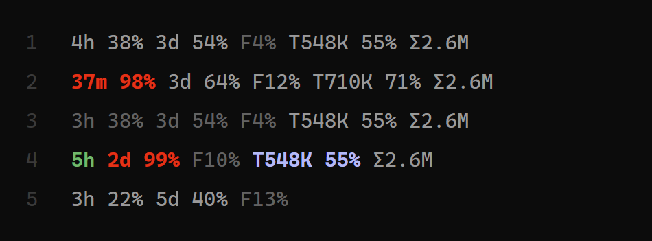

<p align="center"></p>
<h1 align="center">truegauge</h1>
<p align="center">A status line for Claude Code that never shows an old number as a current one.</p>
<p align="center"><sub>by Serpentis AI &middot; <a href="https://serpentis.ai">serpentis.ai</a> &middot; Apache-2.0</sub></p>

```
4h 38% 3d 54% F4% T548K 55% Σ2.6M
```

<p align="center"></p>

1. Normal work: the 5-hour and weekly groups are being spent (bright); Fable is not in use right now (dim).
2. Near the limit: the 5-hour group is red (37 minutes left, 98% used); the work is on Fable, so `F12%` is bright.
3. A pause of over 15 minutes: everything that is not being spent is dim.
4. After a quiet night: a green `5h` (the window has reset, nothing measured here yet), the weekly group red at 99%,
   Fable dim, the context group blue (the cache has gone cold).
5. A new session before its first reply: only the account groups (5-hour, weekly, Fable). The session's own groups
   come with the first reply: the context group (`T...` and its `%`) when Claude Code sends the first context reading,
   `Σ` once something is spent in the session (between your first message and the reply it may read `Σ0` for a
   moment). Nothing is broken: a group with no data yet is simply left out.

A number and its unit are written together; groups are separated by one space. Percentages are **used**,
not left. A group whose data is unknown is left out, never shown as 0. A **dim** number (a darker grey, no bold) is
not live: it is not being spent now, or it is old, or incomplete (see "Dim numbers"). Bright is the line's normal colour.

| Group | Meaning |
|---|---|
| `4h 38%` | 5-hour window: time until it resets (hours; under 1 h minutes, `45m`), and the share used |
| `3d 54%` | the same for the weekly window (all models): always whole days, `0d` in the last day (so it never looks like the 5-hour group) |
| `F4%` | the separate weekly **Fable** allowance, share used |
| `T548K` | tokens in the context window right now (`context_window.total_input_tokens`: input including cache reads and writes) |
| `55%` | how full the context window is |
| `Σ2.6M` | tokens spent in this session: input + cache writes + output, main conversation **and its subagents**, each API message once (cache reads are not in it). A **dim** `Σ` = a lower bound, rounded down (a large transcript is still being read, or a line was unreadable) |

Times are rounded down. Numbers: `812`, `548K`, `2.6M` (decimal point; with `TRUEGAUGE_LANG=ru` the letters
`T K M` are Cyrillic, with `en` they are Latin `T K M`; `h d m F Σ %` are the same in both). A dim percentage
(`38%`) of a plan group is an old reading or a group that is not being spent now; an old reading can only have grown,
so its number is a lower bound (rounded down). Without colour (`NO_COLOR`) the line keeps the signs `≥` and `≤` instead
(see "Dim numbers"). Right after the 5-hour window resets, its group is a green `5h` with no percent
until the next reading arrives (see "Right after a reset"); a weekly window that has reset is left out until then.

## Why another status line

There are many status lines that print the plan limits. Most of them print whatever the last
reading was. But a Claude Code session that sits idle keeps re-sending its **last** reading, and a
number from an hour ago looks exactly like a number from a minute ago. If you plan work by that number
(for example, "there is enough left to let it run overnight"), a stale value is the worst kind of wrong.

truegauge follows three rules:

1. **A replayed reading never wins.** Several sessions share one account. Per window, the reading with
   the later reset time and the higher usage wins; an older, lower reading from an idle session is ignored.
2. **An unchanged reading ages.** When for 15 minutes no plan number has changed and no reply has re-confirmed it, truegauge draws the number dim
   and rounded down ("used at least 38%"; with no colour, `≥38%`). Usage inside a window only grows, so the true figure
   can only be higher.
3. **A window that has reset is not shown with a number** until a new reading arrives: not the number from before
   the reset and not a guessed `0%` (usage from the Claude web app or another session counts against the same limit).
   The 5-hour window shows a green `5h` without a percent; the weekly window is left out.

Any failure leaves the line partial or empty, never wrong, and is written to `~/.truegauge/errors.log`
or shown by `truegauge.py --show`.

## Where the numbers come from

Only documented Claude Code surfaces. Your login token is never read or sent anywhere.

- **5-hour and weekly windows, context:** the JSON Claude Code passes to every status-line command
  (`rate_limits`, `context_window`). Present for Pro and Max plans after the first reply in a session.
- **Session tokens:** the session transcript Claude Code names in that JSON (`transcript_path`) and the
  subagent transcripts next to it. Each API message is counted once (Claude Code writes one message over
  several lines). Only new lines are read on each update.
- **Fable:** the status-line JSON does not carry it. truegauge runs `claude -p /usage` in the background
  at most once every 10 minutes (about 3.5 seconds measured; no settings or hooks loaded, no session saved,
  no model request) and reads the line
  `Current week (Fable): N% used`. If your plan has no separate Fable allowance, the `F` part is not shown.
  Turn this off with `TRUEGAUGE_FABLE=0`. The read runs only if a reply has come since the previous read (the very first read after an install runs at once): an idle
  session starts none (Fable cannot have moved from this machine), so a quiet night starts no Fable reads.

## Install

Requires Python 3.8+ (standard library only) and Claude Code. Put `truegauge.py` anywhere, for example
`~/.claude/truegauge.py`, then:

```
python ~/.claude/truegauge.py --install
```

This makes truegauge your status line in `~/.claude/settings.json` (or `$CLAUDE_CONFIG_DIR/settings.json`;
another file: `--settings PATH`). Your previous status line, if any, is saved first, and a copy of the settings
file is made next to it (`settings.json.truegauge-backup-<time>`) before every change. Running it twice changes
nothing. Open a new Claude Code session to see the line.

`--install` also sets the two hooks of the [agent warning](#agent-warning); `--install --no-agent-hook` leaves them out.

## Turn off

```
python ~/.claude/truegauge.py --uninstall
```

puts your previous status line back, or removes the `statusLine` key if you had none, and takes out truegauge's two hook entries (other hooks stay). If the active line is not
truegauge (you changed it since), the status line is not touched (hook entries of truegauge, if any, are still removed). `python ~/.claude/truegauge.py --status` says whether
truegauge is the active line and whether a previous one is saved. If the settings file is not valid JSON, all
three commands refuse and leave it as it is. The file is rewritten as indented JSON with every key and its order
kept; the backup copy has the exact old bytes.

### By hand (alternative)

Add to `~/.claude/settings.json`:

```json
{
  "statusLine": {
    "type": "command",
    "command": "python ~/.claude/truegauge.py",
    "refreshInterval": 60
  }
}
```

On Windows use the full path, for example `"python C:/Users/you/.claude/truegauge.py"`.
`refreshInterval` keeps the time left moving while the session is quiet. `--uninstall` refuses on a line added
this way (there is no saved previous line, so removing the key would drop it silently); it names the newest backup
and `--uninstall --force` removes the key. (If the file already has an `env` block, add the keys to it, for example `"TRUEGAUGE_LANG": "ru"`; do not
paste a second `env`: it would wipe the keys already there.)

## Settings (environment variables)

| Variable | Default | |
|---|---|---|
| `TRUEGAUGE_LANG` | `en` | `ru` for Cyrillic unit letters (`Т К М`) |
| `TRUEGAUGE_FABLE` | `1` | `0` turns off the background `/usage` read; the last Fable reading stays on the line, dim, until it ages out or its week resets |
| `TRUEGAUGE_PROBE_S` | `600` | seconds between `/usage` reads (minimum 120) |
| `TRUEGAUGE_MAX_AGE_S` | `900` | after this many seconds without spending or change a number is dim (see Dim numbers) |
| `TRUEGAUGE_HOME` | `~/.truegauge` | where the state lives; unset with another `CLAUDE_CONFIG_DIR` than `~/.claude`: `~/.truegauge/cfg-<8 hex>/` (see Dim numbers, accounts) |
| `TRUEGAUGE_DIM_COLOR` | `#626262` | colour of dim numbers: `#rrggbb`, `ansi` (bright black of your theme) or `off` (see Dim numbers) |
| `TRUEGAUGE_RED_5H` | `98` | red threshold of the 5-hour window (see Colors) |
| `TRUEGAUGE_RED_7D` | `99` | red threshold of the weekly window |
| `TRUEGAUGE_RED_COLOR` | `#ff0000` | `#rrggbb` or `ansi` |
| `TRUEGAUGE_COLD_COLOR` | `#b1b9f9` | colour of the context group when the cache is cold: `#rrggbb`, `ansi` or `off` (see Cold cache) |
| `TRUEGAUGE_MARK` | `off` | a list of `underline`, `braces`, `bold`, or `all`, or `off`: a mark without colour (see Mark for colour-blind users; steps for an AI agent follow it) |
| `TRUEGAUGE_AGENT_AT` | `80,90,95` | thresholds (percent) at which the agent is told about the plan limit, or `off` (see Agent warning) |
| `TRUEGAUGE_FRESH_COLOR` | `#4eba65` | colour of the `5h` shown right after a reset: `#rrggbb`, `ansi` or `off` (see Right after a reset) |
| `TRUEGAUGE_TIME` | `short` | `full`: time left in two units everywhere, `4h25m`, `6d14h` (see Time left) |
| `NO_COLOR` | unset | any non-empty value: no colour |

## Right after a reset (green `5h`)

The 5-hour window starts with your first message after a reset, and Claude Code sends the new reading only with a
reply. In between, there is nothing to read. truegauge then shows the window as a green `5h` **with no percent**:

```
5h 3d 54% F4%
```

- `5h` (`5h0m` with `TRUEGAUGE_TIME=full`): nothing has been measured here since the reset. If Claude was not used elsewhere, the whole window is ahead
  (time left is rounded down, so one second into a window it is already `4h`); if it was, both the time and the share
  are unknown until the first reply here.
- No percent: the share is not known here. It may already have been opened from the Claude web app or another
  computer, so `0%` would be a guess. A live reading always carries a percent (`5h 0%` is possible when exactly
  5:00:00 is left or the reset time came rounded up), so the missing percent is the sign, not the `5h`.
- Green is Claude Code's own "success" colour (`#4eba65`). The first reply brings the real reading and the usual
  colour back. `TRUEGAUGE_FRESH_COLOR=off` or `NO_COLOR` leaves a plain `5h`.
- A weekly window that has reset is left out until its next reading (it resets once a week).
- If a reply has already come in this session and Claude Code has not sent a 5-hour reading in it even once (API-key
  billing, another account), the source is silent: the group is left out, not drawn as `5h`. A session that did
  receive the window keeps `5h` after the reset, even though Claude Code may then stop sending the window.

## Time left (`TRUEGAUGE_TIME`)

By default the time is one unit, the largest that still fits whole: days, then hours, and minutes only in the last
hour (`4h`, then `37m`). `TRUEGAUGE_TIME=full` adds the next unit everywhere, still rounded down:

| Left | `short` (default) | `full` |
|---|---|---|
| 4 h 25 min | `4h` | `4h25m` |
| 37 min | `37m` | `37m` |
| 6 d 14 h (week) | `6d` | `6d14h` |
| 14 h (week, last day) | `0d` | `0d14h` |

A wrong value is refused: `short` is used and `--show` names it.

## What it costs your machine

Measured on Windows 11, Python 3.12, Claude Code 2.1.293 (15.10.2026). No tokens: the line makes no model request.

| Part | How often | One run | Per hour |
|---|---|---|---|
| Redraw of the line | every 60 s (`refreshInterval`) and after replies | 0.11-0.17 s, CPU at least 0.08-0.12 s, ~25-31 MB for that moment | about 5-7 s of CPU |
| Fable read (`claude -p /usage`) | at most every 10 min, only after a reply | about 3-3.5 s, CPU about 3 s, ~400 MB for those seconds | up to ~18 s of CPU while you work, 0 while idle |

The redraw is the same whatever the line shows: minutes or hours cost nothing extra. The Fable read is the heavier
part; `TRUEGAUGE_FABLE=0` removes it.

## Colors

A window group (time and percent together, e.g. `4h 98%`) turns **bold red** when that window's reading has
reached a threshold:

| Window | Threshold variable | Default |
|---|---|---|
| 5-hour | `TRUEGAUGE_RED_5H` | `98` |
| weekly | `TRUEGAUGE_RED_7D` | `99` |

A threshold is an integer 1..100, or `off` (also `0`) for never. Empty or unset means the default; anything else
(`101`, `-1`, `97.5`, `abc`) is refused, the default is used, and `--show` names the refusal. Spaces around the
value are ignored.

How to set them: the main path is the `env` block of `~/.claude/settings.json`, which Claude Code documents as reaching every command it starts (so the status line too; not measured by the
tests):

```json
{ "env": { "TRUEGAUGE_RED_5H": "95", "TRUEGAUGE_RED_7D": "off", "TRUEGAUGE_RED_COLOR": "#ff5500" } }
```

The second path is an `export` in your shell before starting Claude Code. `python truegauge.py --show` prints two
lines: the values of **that shell**, and the settings **the status line itself last used** (it saves them in the
state file when they change, so an `env` block in settings.json shows up there, with the time it was seen). The
"past the red threshold" verdict follows the second one; before the status line has saved anything it says
`unknown`. A refused value (say `"95%"`) is also recorded once, as the last fault of an extra (`--show` prints it); like any
fault of an extra of the line (colours, the cache and context records, `Σ`, the start of the Fable probe), it never makes
the plan numbers dim.

- `TRUEGAUGE_RED_COLOR`: `#rrggbb` (any case, default `#ff0000`) or `ansi`. `ansi` is the bold red of your terminal
  theme, so its shade depends on that theme (it can look crimson in some). A wrong value is refused like a
  threshold. The group is closed with `ESC[22;39m` (bold off, default foreground; see the last note below); the
  space between groups is never coloured.
- `NO_COLOR`: any non-empty value turns colour off entirely, and the output is then byte for byte the same as 0.1
  (while `TRUEGAUGE_MARK` is unset). An empty value does not.
- Only the two plan windows turn red. Fable, tokens and the context fill never do (the context group has its own
  blue, see Cold cache below); a reset 5-hour window is a green `5h` (see Right after a reset), a reset weekly
  window has no group.

The colour follows the **raw reading**: red when the reading, rounded half up, is at or above the threshold. For a
fresh reading that is the number you see. For an old one it is true too: an old reading shown as `97%` (dim) can be red at threshold 98,
because the reading behind it was 97.6 (shown as 98% while fresh) and usage inside a window only grows. Ageing
changes the text (`98%` becomes `97%`, rounded down), never the red.

**Which colour wins.** Red beats dim, and dim beats blue; the green `5h` is never dim. A red group is never dim, even
if it is not being spent, and a red group built from an old reading carries neither dim nor a sign (with `TRUEGAUGE_DIM_COLOR=off` it keeps its `≥`): red wins (the old
reading had already reached the threshold and use only grows), and its number is a lower bound, rounded down (`97%` for
a raw 97.6). The saved context reading (after `/compact`, before the first reply) is dim ALWAYS, even when the cache
is cold: the number is not live, so it does not get the blue. Blue is only for a live context reading. The colours in
one place:

| Colour | Means |
|---|---|
| red (bold) | a plan window has reached its threshold |
| blue (bold) | the context group, a live reading, the prompt cache has gone cold |
| green (bold) | `5h` right after a reset, nothing measured here yet |
| dim (`#626262`, not bold) | the number is not live (see Dim numbers) |

What the line does **not** tell you:

- With `NO_COLOR`, `off`, or a refused value there is no near-the-limit sign on the line at all: a plain `97%`
  looks the same as a plain `40%`. `--show` tells you which of these is in force.
- An old reading that is not red does not mean "far from the limit". An OLD reading (dim, rounded down) means "at least": a
  dim `95%` of an old reading can be a real 100% that has not been read again yet. (A dim number of a fresh reading is
  only "not being spent now"; it is not a bound.)
- The group is closed with `ESC[22;39m`, which switches off bold **and also faint**. If Claude Code draws the
  status line faint, the items after a red group may look brighter than the rest. The dim group is closed with the
  same `ESC[22;39m`, so the same caveat holds for it: if Claude Code, after that reset, draws the next text in the
  terminal's own colour instead of its own grey, the text after a dim group may look lighter than the rest. This is not
  measured in Claude Code (it can only be seen in a terminal). If you cannot see the red at all, try
  `TRUEGAUGE_RED_COLOR=ansi`.

## Dim numbers (`TRUEGAUGE_DIM_COLOR`)

A dim number is not live. There are no `≥` / `≤` signs on the line (they raised the question "what is this sign?"); a
number that is not live is drawn in a darker grey instead. The default is `#626262`, not bold. Claude Code draws the
whole line muted, and plain text in a live terminal is rgb(153,153,153) (measured, dark theme), so the dim has to be
visibly darker than that.

Dim means one of four things:

1. **The group is not being spent.** The plan groups (5-hour, weekly, Fable) belong to the account, not to a window.
   A group is bright when, within the last `TRUEGAUGE_MAX_AGE_S` (900 s), any window of this account on this computer
   got a reply, or the number grew. For Fable the reply must have been made by a Fable model: the model is read from
   the reply itself in the transcript, for the main session **and its subagents**. A subagent on Fable lights `F`;
   switching the model with `/model` and no reply does not. Replies of subagents also count as spending of the account
   (5-hour, weekly). Otherwise the group is dim. It lights at the next update of the line after a reply and goes dim
   after 900 s without spending.
2. **The reading is old** (what used to be `≥`): the number is rounded down, and dim. A Fable reading with a known
   reset counts as old only after 2 x `TRUEGAUGE_MAX_AGE_S` (it is read by `/usage` every `TRUEGAUGE_PROBE_S`, not
   with every reply); between 900 and 1800 s it is dim as not being spent, its number still rounded half up.
3. **The context is the saved reading** after `/compact` or before the first reply (what used to be `≤`): the numbers
   are still rounded UP. It is dim **always**, even when the cache is cold (the number is not live).
4. **The `Σ` count is incomplete** (what used to be `Σ≥`): the number is still rounded DOWN.

Order of colours: red beats dim, dim beats blue (blue is only for a live context reading); the green `5h` is never dim.
A red group made of an old reading is just red: no dim and no sign (with `TRUEGAUGE_DIM_COLOR=off` it keeps its `≥`), and its number is a lower bound, rounded down.

Rules for what counts as spending:

- **A reply in a session without plan limits** (billing by API key) lights nothing: it spends nothing of the plan.
- **Fable growth between two `/usage` reads** counts only UPWARD, and only if the previous read was no older than
  2 x `TRUEGAUGE_PROBE_S` (by default 1200 s). A drop (a new week) and growth after a longer gap are not spending
  "now": when it was spent is unknown.
- **A time from the future** (the clock was set back) does not hide real spending: such a time is ignored.

Without colour (`NO_COLOR`, or `TRUEGAUGE_DIM_COLOR=off`) there is no dim. Then the line puts the old signs back
(`≥` on an old reading, `≤` on the saved context, `Σ≥` on an incomplete count), so the meaning is not lost silently. A
fresh number that is simply not being spent is not marked at all in that case. `TRUEGAUGE_DIM_COLOR`: `#rrggbb`
(default `#626262`), `ansi` (the bright black of your terminal theme, `ESC[90m`) or `off`. A wrong value: the default
is used and `--show` names the refusal.

**Right after an install or an update**, until the first reply, everything is dim: there is no record of spending yet.

**Two accounts.** Each account keeps its own state, or its readings would mix. If `TRUEGAUGE_HOME` is not set and
`CLAUDE_CONFIG_DIR` is set to a folder other than `~/.claude`, the state lives in `~/.truegauge/cfg-<8 hex>/` (8 hex
digits of a fingerprint of that folder's REAL path, `realpath`: shortcuts, junctions and short names of one folder do
not make two accounts). The default folder `~/.claude`, or no variable, keeps the old `~/.truegauge`.
`TRUEGAUGE_HOME`, if set, wins. If you already had `CLAUDE_CONFIG_DIR` set before 0.4, after the update the state
starts in the new folder: until the first reply the line is dim (the readings arrive again). A relative
`CLAUDE_CONFIG_DIR` is a limit: its path is taken from the current folder of the process, so different processes can
land in different state folders; set an absolute path.

`python truegauge.py --show` prints `dim colour: ...` (your shell), `status line dim colour: ...` (what the running line
used), for every window `being spent now: yes|no (last spend seen: ...; bright for 900 s after it, dim otherwise)`, and,
when `TRUEGAUGE_HOME` is not set, an `account: ...` line: with `CLAUDE_CONFIG_DIR` it says where that leads; without it
the line says `no CLAUDE_CONFIG_DIR in this shell -> the default state folder; a Claude Code started with
CLAUDE_CONFIG_DIR keeps its own (set the same variable before --show)`.

## Cold cache (blue context group)

**Measured on one install** (Claude Code 2.1.293, the author's machine, 2026-10-12, two sessions): `prompt_cache`
does arrive in the status line; `expires_at` came as epoch seconds about one hour ahead, and `ttl` as the string `"1h"`
(truegauge does not read `ttl`). On another version or install this is not known: no blue does NOT mean a warm cache
until `python truegauge.py --show` has shown `present=True` (otherwise the `cache:` line says `cold now: unknown`).

The context group (`T548K 55%`, both parts together) turns **blue** when the prompt cache of your main session has
gone cold. A cold cache means the next message re-sends the whole context at full price instead of the cheap cached
price, so this is the moment to think before sending a long-context message.

- **Where the data comes from.** Claude Code's status-line input carries a `prompt_cache` object (its documentation:
  main session only, from v2.1.251; subagents are not counted). truegauge reads `caching_observed`, `warm` and
  `expires_at` from it.
- **Cold** means: `caching_observed` is `true` AND (`warm` is `false` OR `expires_at` is a time in epoch SECONDS that has passed; a value outside 2017-07-14 .. 2100-01-01 (for example
  milliseconds) is not judged; the unit, taken from the documentation, matched the live input measured above).
  No `prompt_cache`, one of another type, caching not observed, or a field of the wrong type means **not cold**: no
  data is never shown as cold. Claude Code's status line documentation (section "When the status line updates") says when the line is
  re-run; truegauge relies on that for the blue to appear without a new message when a warm cache reaches
  `expires_at`. If the line is not re-run at that moment, the blue appears at the next redraw (the documentation
  text was not re-read for this version of the README).
- **How long a cache lives.** On a subscription, within the plan, the main session's cache lives 1 hour; when usage
  goes over the plan it is 5 minutes, so blue appears more often then.
- **What is not coloured.** `Σ` (tokens spent in the session, subagents included) is never blue: the cache state
  is known for the main session only, so it cannot say anything about the subagents' part (it is dim only when the
  count is incomplete). Fable and the window groups keep their own rules. Before the first reply of a session there is
  no context reading and nothing to colour; after `/compact` the group shows the saved reading as an upper bound (see
  the next section); it is dim always, also when the cache is cold (the saved number is not live, so it gets no blue).
  Blue is only for a live reading. Without a dim colour (`NO_COLOR`, `TRUEGAUGE_DIM_COLOR=off`) the saved reading keeps
  its `≤` sign and can be blue.
- **Colour.** `TRUEGAUGE_COLD_COLOR`: `#rrggbb` (default `#b1b9f9`, bold; the blue Claude Code itself uses for `/clear` in its idle hint «new task? /clear to save N tokens», dark theme), `ansi` (the bold bright blue of your
  terminal theme) or `off` / `0` (no colour). Empty or unset = default; anything else is refused, the default is used
  and `--show` names the refusal. `NO_COLOR` removes this colour too. The group is closed with `ESC[22;39m`, like the
  red ones.
- **Check that the data really arrives.** The status line keeps the last `prompt_cache` it saw in the state file, and
  `python truegauge.py --show` prints it: `cache: as the status line saw it at <time>: present=..., warm=..., ttl=...,
  expires in N s / expired N s ago, recache_if_cold=..., cold now: yes / no / unknown (reason)`. The time in that line
  is when the record last CHANGED; the next line, `status line last call: <time> (accurate to 60 s; session ...)`,
  is when the line last ran (the state file is shared by all sessions: the tags tell which session made the call
  and which made the change). `cache: no record yet` means the line has
  not run since this version was installed; `present=False` means Claude Code did not send the object (then blue
  never appears, by the rule above). The arrival of `prompt_cache` on a given install is not asserted by the tests.

## Compaction while idle (Claude Code, not truegauge)

This is Claude Code's own behaviour. truegauge does not cause it, does not change it and does not switch it off; it
is described here because it changes what the context group shows. Whether to keep it is up to you and your agent.

When a long session sits idle, Claude Code may compact the conversation by itself shortly before the prompt cache
goes cold. The screen says «Compacting conversation…» and then «Compacted while idle, before the prompt cache
expired». Without anyone typing, the conversation is replaced by its summary.

**Read in the program and measured on one install** (Claude Code 2.1.293, the author's machine; read in the program
2026-10-11, not found in its documentation; observed twice, 2026-10-11 and 2026-10-15). Another version may differ.

- **When.** After 0.9 of the cache lifetime without a reply: with the 1-hour cache, 54 minutes after the last reply
  (both observations: 54 min). Any reply restarts the count, also one the agent gives to a hook, not only your
  message.
- **Only if** the context is at least 200 000 tokens (the floor can be moved with the environment variable
  `CLAUDE_CODE_IDLE_COMPACT_MIN_TOKENS`, not below 100 000), automatic compaction is on, nobody touched the terminal
  in the last 60 s, and usage is not at the plan limit. With the 5-minute cache (usage over the plan) it does not run.
  It is switched on by Anthropic from their side, so on another account it may not happen at all.
- **What it costs and gives.** The compaction is one request: it reads the whole context from the still warm cache
  and writes a summary (about 3.5K output tokens in the 2026-10-15 case, 484K context). When you come back, the next
  message re-sends the short summary instead of the whole context (2026-10-11: about 89K written to the cache
  instead of about 420K). The price: the work goes on from a summary, not from the full conversation.
- **What the line shows after it.** Claude Code then sends 0 context tokens, as after `/compact` (measured
  2026-10-11), so the context group shows the saved reading, dim (see the next section).
- **Smaller contexts.** Between 100 000 and 200 000 tokens there is no compaction; instead Claude Code shows the hint
  «new task? /clear to save N tokens» after about 75 minutes idle.
- **Turn it off.** The program names the setting `"idleCompaction": false` in `~/.claude/settings.json` («Set to false
  to stop Claude Code from compacting a long conversation while the session is idle»). The author has not tried it:
  that it works is not asserted here.

## Context after `/compact`

Claude Code sends 0 context tokens before the first reply and after `/compact`. Instead of dropping the context group,
truegauge keeps the last real reading of the SAME session and draws it dim: `T549K 55%`. Tokens and percent
are rounded UP, so the number stays an upper bound (548 200 tokens -> `T549K`). Without a dim colour (`NO_COLOR`,
`TRUEGAUGE_DIM_COLOR=off`) the group carries `≤` instead: `≤T549K ≤55%`. With a dim colour the saved reading is dim
ALWAYS, even if the cache is cold: the number is not live, so dim beats blue. (Without a dim colour the group keeps the
sign and can be blue.) `python truegauge.py --show` prints
`context: live`, or `context: last reading ... (session ...) at ...; stale since ...`. Another session's reading, no
saved reading, or a damaged record -> no group: nothing is guessed.

Limits of this:

- The upper bound (dim, or `≤`) rests on an assumption written in the code: after `/compact` the context only gets smaller. It held on a large
  context (where it was used); on a small context, or if the model's context window changes between the reading and
  `/compact`, it is not measured, and the real value could be higher than the bound.
- There is one saved reading for all sessions. If another session writes its reading in between, this session's group
  is not shown after `/compact` (the number of the other session is never shown instead; without a saved reading the
  line behaves as 0.2 did).
- The saved reading has no expiry: a session resumed days later still shows its old dim reading. The bound stays true,
  but it can be far from the real value.
- `--show` prints `context: live` without the age or the session of that reading.

## Mark for colour-blind users (underline, braces, bold)

If you do not tell the colours apart there is a mark that needs no colour. **It is off by default.** Nothing changes
on your line until you switch it on.

**What it is put on.** Exactly the groups that get a colour, under the same conditions: a window group at or above
its red threshold (`4h 98%`) and the context group when the cache is cold (`T548K 55%`; a saved reading after `/compact` is dim, not cold-painted,
and gets no mark while a dim colour is in force). `Σ` and Fable never get a mark. It does not depend on colour: with `NO_COLOR` set or `TRUEGAUGE_COLD_COLOR=off` the mark is still drawn (that
is who it is for). A threshold set to `off` is "no condition", so no mark either. When nothing is past a threshold
and the cache is warm, the line is byte for byte the same as without the setting.

**What you can choose.** `TRUEGAUGE_MARK` is a **list** of elements separated by commas, or `all`, or `off`:

| Element | What it does | Looks like |
|---|---|---|
| `underline` | the group is underlined (`ESC[4m` ... `ESC[24m`; the end switches off only the underline) | <u>4h 98%</u> |
| `braces` | the group is put in curly braces (square brackets blend into the text, so they were rejected) | `{4h 98%}`, `{T548K 55%}` |
| `bold` | the group is bold. **With colour on it adds nothing visible**: the red and blue sequences are already bold, and truegauge does not add the bold a second time. Without colour (`NO_COLOR`, colour `off`) the group gets its own `ESC[1m` ... `ESC[22m` | **4h 98%** |
| `all` | the same as `underline,braces,bold` | `{4h 98%}`, underlined and bold |
| `off` (or empty, or unset) | no mark | `4h 98%` |

Rules for the list: any case, spaces around an element are ignored, order does not matter, a repeat (`bold,bold`) is
harmless. **One unknown element refuses the whole setting**: no mark at all (nothing is switched on halfway), and
`--show` names the element. **If the mark is not visible,** run `python truegauge.py --show`: the line
`status line cold colour: ...; mark: ...` is what the running line really used, and a
`REFUSED (default used): TRUEGAUGE_MARK=...` part names a value that was rejected (nothing is added to the status line itself, and the
refusal is also recorded as the last fault of an extra, which `--show` prints; it never makes the plan numbers dim).

Example, a line with the 5-hour window past its threshold and a cold cache (`ESC` sequences are invisible; this is
the text you see):

```
no mark              4h 98% 3d 54% T548K 55% Σ2.6M
braces               {4h 98%} 3d 54% {T548K 55%} Σ2.6M
underline            4h 98% 3d 54% T548K 55% Σ2.6M      (the two marked groups are underlined)
all                  {4h 98%} 3d 54% {T548K 55%} Σ2.6M  (underlined and bold as well)
```

**Do the curly braces affect anything?** No. Nobody parses the status line: Claude Code only prints it into the
terminal, where `{` and `}` are ordinary characters (truegauge itself never reads its line back; if you pipe the
line through some other tool of your own, that tool is the only place braces could matter, and we cannot see it). Inside truegauge the text of a group is joined with `+`, never used as a format template, so
`{`, `}` and `%` in the text cannot break the line (the tests feed groups with braces, `%`, `≥` and Cyrillic).

**Switch it on.** Add it to the `env` block of `~/.claude/settings.json`:

```json
{ "env": { "TRUEGAUGE_MARK": "all" } }
```

(or any list, for example `"underline,braces"`). **Switch it off:** delete the key, or set it to `"off"`.
**Check:** `python truegauge.py --show` prints `mark: ...` for your shell and `status line ... mark: ...` for the
setting the status line itself used last (it appears after the line has run once with the new setting). A refused
value shows up in the `REFUSED` line. How underline and bold look inside Claude Code's status line has to be checked
by eye; the tests check the characters only. To see the mark at once without waiting for 98%, set
`TRUEGAUGE_RED_5H` to `1` for a minute and put it back.

## Agent warning

The status line is drawn for the human; the model never sees it. From 0.4 the same state also reaches the agent:
`--install` sets two Claude Code hooks (`PostToolUse` and `UserPromptSubmit`) that run `truegauge.py --hook`.
When a plan window passes a threshold the hook adds one short line to the agent's context, for example:

```
Claude plan usage (truegauge): 5-hour window 91% used, resets in 1h; weekly window 64% used, resets in 3d.
```

- **Thresholds:** `TRUEGAUGE_AGENT_AT`, default `80,90,95` (integers 1..100, comma-separated). `off` (or `0`) -- the hook
  is always silent. A wrong value is refused as a whole: the default is used, and the refusal is written into the
  hook's own record, which `--show` prints (so a value set in the `env` block of settings.json, which a shell does not
  see, is named too). The `env` block does reach the hook (checked in Claude Code 2.1.293).
- **Once per threshold, in each session.** A window's level is the largest threshold not above its used share (exactly
  80.0 is already level 80; 79.99 is not). A session is told when a level rises above the one already announced TO IT
  for the same window (its end, `resets_at`, within 10 minutes); a jump from 70% to 91% is one message of level 90, not
  two. A new window starts again from nothing. Sessions are told separately (by the hook's `session_id`): a background
  `claude -p` on the same account does not use up the warning of your main session -- it gets its own. So does each
  subagent: Claude Code gives a subagent's tool calls the parent's `session_id` and their own `agent_id`, and the record
  key is `session_id#agent_id` for them. What was announced is kept in `~/.truegauge/agent_warned.json`
  (`{"sessions": {key: {window: {"resets_at": ..., "level": ...}, "seen": ...}}, "hook": {...}}`); a record is dropped
  8 days after it was last told, and at most 200 are kept.
- **Both windows (5-hour and weekly) in one line**, as soon as either has passed a threshold. A window that has ended
  is left out. An old reading is written as `at least 91% used (reading 14 min old)`. `TRUEGAUGE_LANG=ru` gives the
  Russian text. The text states facts; it gives no orders (an imperative in hook text can be taken by the model for an
  injection and shown to the human).
- **Never in the way, never silent without a reason.** Any fault -- unreadable input, a damaged file -- gives empty
  output and exit code 0. Every outcome of the hook (spoke; below the thresholds or already told; no usable plan window
  in the state file; off; an event that is not its own; a fault) is written into the hook's own record when it changes,
  and `--show` prints it as "agent hook, as the hook saw it". A hook fault does not touch the state file, so it never
  marks the numbers of your status line as old.
- **Turn off:** `TRUEGAUGE_AGENT_AT=off` in the `env` block, or install without the hooks:
  `python ~/.claude/truegauge.py --install --no-agent-hook`. `--uninstall` removes only the hook entries that carry
  `truegauge.py` and `--hook`; your other hooks stay. `--status` says whether the hooks are set in that settings file,
  and names `disableAllHooks: true` and a hook of ours that runs another copy of the file or another Python (moved?). `--show` says what
  has been announced and the hook's last outcome.

## For an AI agent: set it up without the human

Do these steps in order; stop at the first one that fails and tell the human what you saw. Nothing here needs a
restart of your own process.

1. **Find the settings file.** `$CLAUDE_CONFIG_DIR/settings.json` if that variable is set, otherwise
   `~/.claude/settings.json` (Windows: `C:/Users/<name>/.claude/settings.json`). If the file does not exist or is not
   valid JSON, **stop**: do not create or rewrite it, ask the human.
2. **Make a copy first**: `settings.json.bak-<date>` next to it.
3. **Read, add the key, write back; never replace the block.** The `env` object may already hold other keys; they
   must survive. If `env` exists and is not an object, stop. Also look for the same key in the project's
   `.claude/settings.json` and `.claude/settings.local.json`: a project or local setting can take precedence over the
   user file, and then your change would not show. A ready snippet (change the two lines `KEY`/`VALUE`):

   ```python
   import json, os, shutil, time
   KEY, VALUE = "TRUEGAUGE_MARK", "all"
   path = os.path.join(os.environ.get("CLAUDE_CONFIG_DIR") or os.path.expanduser("~/.claude"), "settings.json")
   with open(path, encoding="utf-8") as f:
       data = json.load(f)                      # invalid JSON raises: stop here, write nothing
   shutil.copy2(path, path + ".bak-" + time.strftime("%Y%m%d%H%M%S"))
   env = data.setdefault("env", {})
   assert isinstance(env, dict), "env is not an object"
   env[KEY] = VALUE                             # other keys of env stay untouched
   with open(path, "w", encoding="utf-8") as f:
       json.dump(data, f, indent=2, ensure_ascii=False)
   ```

   The file is rewritten with 2-space indentation; keys keep their order; comments are not allowed in JSON, so there
   is nothing to lose (if the file had any, step 1 already stopped you).
4. **Values, verbatim.** `TRUEGAUGE_MARK`: `underline`, `braces`, `bold`, any comma list of them (`"underline,braces"`),
   `all`, `off`. Examples of ready fragments for the `env` block:

   ```json
   { "env": { "TRUEGAUGE_MARK": "all" } }
   { "env": { "TRUEGAUGE_MARK": "underline,braces" } }
   { "env": { "TRUEGAUGE_MARK": "bold" } }
   { "env": { "TRUEGAUGE_MARK": "braces", "TRUEGAUGE_COLD_COLOR": "ansi", "TRUEGAUGE_RED_5H": "95" } }
   ```

   Use the last form's idea for several settings at once: all keys go into the same `env` object.
5. **Check.** Success is the line `status line cold colour: ...; mark: <your value>` in `python truegauge.py --show`
   AFTER the status line has been redrawn: it holds what the running line actually used. A variable set in your
   shell proves nothing about the running line (it changes only the lines marked "THIS shell"). Also make sure no
   `REFUSED (default used)` part mentions the variable. Shell syntax differs: bash `python truegauge.py --show`; for a
   preview of a value in PowerShell: `$env:TRUEGAUGE_MARK = "all"; python truegauge.py --show`; in cmd:
   `set TRUEGAUGE_MARK=all && python truegauge.py --show` (`TRUEGAUGE_MARK=all python ...` works in bash only).
6. **When it takes effect.** The status line reads its settings at every redraw, so the change should show at the next
   redraw. Whether Claude Code re-reads `settings.json` `env` without a restart is **not measured**: if the
   `status line ... mark:` line still shows the old value after a few redraws, ask the human to restart Claude Code.
7. **Roll back.** Delete the key from `env` (or restore the `.bak-...` copy). An empty value (`""`) also means "not
   set".

### All settings of the line

Each one goes into the same `env` block (or the shell, before starting Claude Code). An empty value means "not set"
for all of them. A wrong value of a threshold, a colour, the mark or the time mode is refused: the default is used and `--show`
names the refusal (`TRUEGAUGE_LANG` and `NO_COLOR` are not checked that way, see their rows). The four settings of the
reading itself -- `TRUEGAUGE_FABLE`, `TRUEGAUGE_PROBE_S`, `TRUEGAUGE_MAX_AGE_S`, `TRUEGAUGE_HOME` -- are in the table
under Settings (environment variables) and are not checked either: a value that is not a whole number of seconds (`15m`)
silently gives the default, and only `TRUEGAUGE_FABLE=0` turns the Fable read off (`off`, `no` do not).

| Name | Values | Default | What it changes |
|---|---|---|---|
| `TRUEGAUGE_MARK` | list of `underline`, `braces`, `bold`; or `all`; or `off` | `off` | a mark that needs no colour on the groups that get a colour (see above); one unknown element refuses all |
| `TRUEGAUGE_COLD_COLOR` | `#rrggbb`, `ansi`, `off` / `0` | `#b1b9f9` | colour of the context group (`T548K 55%`) when the main session's cache is cold |
| `TRUEGAUGE_RED_5H` | integer 1..100, `off` / `0` | `98` | percent at which the 5-hour group turns red (`off`: never) |
| `TRUEGAUGE_RED_7D` | integer 1..100, `off` / `0` | `99` | the same for the weekly group |
| `TRUEGAUGE_RED_COLOR` | `#rrggbb`, `ansi` | `#ff0000` | colour of the red window groups |
| `TRUEGAUGE_AGENT_AT` | integers 1..100 separated by commas, `off` / `0` | `80,90,95` | thresholds at which the agent is told about the plan limit (see Agent warning) |
| `TRUEGAUGE_FRESH_COLOR` | `#rrggbb`, `ansi`, `off` / `0` | `#4eba65` | colour of the `5h` shown right after a reset |
| `TRUEGAUGE_TIME` | `short`, `full` | `short` | time left in one unit (`4h`) or two (`4h25m`, `6d14h`) |
| `TRUEGAUGE_DIM_COLOR` | `#rrggbb`, `ansi`, `off` | `#626262` | colour of numbers that are not live (not being spent now, old, incomplete); `off`: no dim, the signs `≥` `≤` `Σ≥` return |
| `NO_COLOR` | any non-empty value | unset | no colour at all (a mark, if set, stays) |
| `TRUEGAUGE_LANG` | `en`, `ru` | `en` | unit letters: Cyrillic (`Т К М`) for `ru`; any other value silently gives English |

## Check it

```
python truegauge.py --show
```

prints what the tool would conclude right now (fresh / stale / reset for every window, Fable included)
and its own health: when it was last called, the last error, rejected readings.

## Tests

```
python tests/test_truegauge.py   # boundary values at every threshold
python tests/mutants.py          # breaks the code on purpose; every break must turn the tests red
```

## Limits (said plainly)

- The weekly Fable reset time is not machine-readable; truegauge uses the weekly reset when `/usage`
  prints the same reset text for both, otherwise only the percentage is shown.
- The `/usage` text is not a documented format. If it changes, the `F` part disappears and `--show`
  says why. It never shows a guessed number.
- Token counts are what the API reported per message. They are not the plan's internal weighting of
  usage and cannot be converted into "percent of limit".
- The Fable read skips idle periods by the time of the last reply any session reported. Fable spent from the Claude
  web app or another computer while this machine is idle shows only after the next reply here (until then the
  old reading goes dim, or is dropped when its reset time is unknown). A failed read is retried after the next
  reply, not sooner. If the session transcript cannot be read, a reply that moves no plan number is not seen as
  activity, and the read waits for one that does.
- The line trusts the computer's clock. A clock running ahead shows a reset window as `5h` too early (and shifts
  every time left).
- Each background `/usage` read creates an empty project folder for `~/.truegauge` under
  `~/.claude/projects/` (one folder, not one per read).
- Staleness is judged by the last time ANY plan number changed, not per window.
- Several sessions write one state file under a short lock; if the lock cannot be taken within about
  1 second the update goes ahead, and a lost update is repaired by the next reading.
- A Fable reading is dropped (not shown as a bound) when it is old and its reset time is unknown,
  and it ends when a newer weekly window starts.
- On a very large transcript the first count is finished over several refreshes and shown dim (`Σ≥` without colour);
  a line that cannot be read also turns the count into a dim lower bound.
- One state directory per Claude account. Different settings folders (`CLAUDE_CONFIG_DIR`) are kept apart by
  themselves (`~/.truegauge/cfg-<8 hex>/` of the real path, see Dim numbers). A re-login as ANOTHER account into the SAME settings folder
  is not told apart: one folder, one record; give each login its own `TRUEGAUGE_HOME` or settings folder.
- Brightness follows replies seen by the windows of THIS computer. Spending on another computer or in the Claude web
  app shows only as growth of the number: the 5-hour and weekly groups with the next reply here; Fable with the next
  `/usage` read (at most once in 600 s, only when the percent moved by a whole point, and only upward, if the
  previous read was no older than 2 x `TRUEGAUGE_PROBE_S`; after a longer gap the growth is not counted as "now").
- A reply counts by the model that made it, read from the transcript: a Fable subagent lights `F`; switching the model
  with `/model` and no reply does not. A reply in a session without plan limits (API-key billing) lights nothing.
- A red group made of an old reading has neither dim nor a sign (with `TRUEGAUGE_DIM_COLOR=off` it keeps its `≥`): red wins. This is honest (the old reading had already
  reached the threshold and use only grows), but its number is a lower bound, rounded down (`97%` for a raw 97.6).
- Not measured: the dim group is closed with the same `ESC[22;39m` as the red one; if Claude Code, after that reset,
  draws the next text in the terminal's colour instead of its own grey, the text after a dim group may look lighter.
- `--show` run from an ordinary shell sees the variables of the SHELL. If Claude Code was started with
  `CLAUDE_CONFIG_DIR` and the shell has none, `--show` looks into the default folder (and its `account:` line says
  so); set the same `CLAUDE_CONFIG_DIR` before `--show`.
- A relative `CLAUDE_CONFIG_DIR` is taken from the current folder of the process: different processes can land in
  different state folders. Set an absolute path.
- Until the first reply after an install or an update everything is dim (no record of spending yet).
- A session that once received the 5-hour window is remembered for 14 days as one that has it. If the same session
  is switched to API-key billing or another account (`/login`), a reset window can still be drawn as `5h`: Claude
  Code sends no account name to the status line, so the switch is not seen.
- A transcript replaced by a different file of greater length is not detected (transcripts are append-only).
- The blue context group follows the cache of the MAIN session only. Subagents have their own cache (5 minutes
  according to Claude Code's documentation) and the line cannot see it; `Σ` is not coloured for that reason.
- Whether `prompt_cache` reaches your status line is a property of your Claude Code version; `--show` tells you
  (`cache:` line). Without it there is no blue, and nothing is guessed.
- The agent warning knows only what the status line saw last. If the line has not been redrawn for a while the
  warning says `at least` and the age of the reading. Fable is not part of the warning. The hook runs on an action of
  the agent or a message of the user: while the session is idle it is silent. "Once" can become twice: if two calls
  meet while the record's lock is held for over a second, the second proceeds without it and may say the same.
- After `/compact` the context group is an upper bound from a saved reading, always dim; its own limits are listed
  under "Context after `/compact`".

## License

Apache-2.0. Not affiliated with Anthropic. Claude and Claude Code are trademarks of Anthropic.
