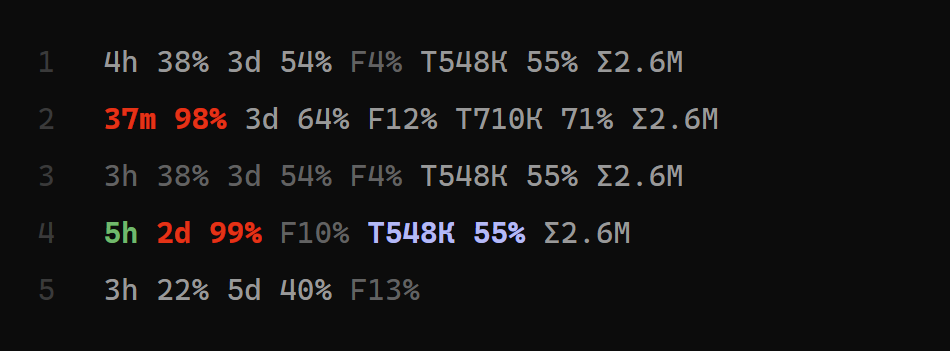

<p align="center"></p>
<h1 align="center">truegauge</h1>
<p align="center">Строка состояния для Claude Code, которая не выдаёт старое число за текущее.</p>
<p align="center"><sub>Serpentis AI &middot; <a href="https://serpentis.ai">serpentis.ai</a> &middot; Apache-2.0</sub></p>

```
4h 38% 3d 54% F4% Т548К 55% Σ2.6М
```

<p align="center"></p>

1. Обычная работа: пятичасовая и недельная группы тратятся (яркие); Fable сейчас не используется (тусклый).
2. У предела: пятичасовая группа красная (осталось 37 минут, израсходовано 98%); работа идёт на Fable, поэтому `F12%`
   яркий.
3. Пауза больше 15 минут: всё, что не тратится, тусклое.
4. После тихой ночи: зелёное `5h` (окно сброшено, здесь ещё ничего не измерено), недельная группа красная на 99%,
   Fable тусклый, группа контекста голубая (кэш остыл).
5. Новая сессия до первого ответа: только группы аккаунта (пятичасовая, недельная, Fable). Группы самой сессии
   приходят с первым ответом: группа контекста (`T...` и её `%`) -- когда Claude Code пришлёт первое показание
   контекста, `Σ` -- когда в сессии что-то потрачено (между первым сообщением и ответом может на миг показаться `Σ0`).
   Это не сбой: группа, для которой данных ещё нет, просто не показывается.

Число и его единица пишутся слитно; группы разделены одним пробелом. Проценты -- **израсходовано**, а не
осталось. Группа, данных для которой нет, пропускается, нулём она не показывается. **Тусклое** число (более тёмный
серый, не жирный) не живое: оно сейчас не тратится, либо старое, либо неполное (см. «Тусклые числа»). Яркое -- обычный
цвет строки.

| Группа | Что значит |
|---|---|
| `4h 38%` | пятичасовое окно: время до сброса (часы; меньше часа -- минуты, `45m`) и доля израсходованного |
| `3d 54%` | то же для недельного окна (все модели): всегда целые дни, в последние сутки `0d` (так его не спутать с пятичасовым) |
| `F4%` | отдельный недельный лимит **Fable**, доля израсходованного |
| `Т548К` | токены в контекстном окне сейчас (`context_window.total_input_tokens`: вход, включая чтение и запись кэша) |
| `55%` | насколько заполнено контекстное окно |
| `Σ2.6М` | токены этой сессии: вход + запись в кэш + ответ, основной разговор **вместе с субагентами**, каждое сообщение API один раз (чтение из кэша сюда не входит). **Тусклое** `Σ` -- нижняя граница, округлена вниз (большая запись ещё читается или строка нечитаема) |

Время округляется вниз. Числа: `812`, `548К`, `2.6М` (десятичная точка; буквы `Т К М` кириллические при
`TRUEGAUGE_LANG=ru`, латинские `T K M` при `en`; `h d m F Σ %` одинаковы). Тусклый процент (`38%`) у группы плана --
старое показание либо группа, которая сейчас не тратится; старое показание могло только вырасти, поэтому его число --
нижняя граница (округлена вниз). Без цвета (`NO_COLOR`) строка вместо этого ставит знаки `≥` и `≤` (см. «Тусклые числа»).
Сразу после сброса пятичасового окна его группа -- зелёное `5h` без процента, пока не придёт новое показание
(см. «Сразу после сброса»); сброшенное недельное окно до тех пор не показывается.

## Зачем ещё одна строка

Строк, которые показывают лимиты плана, много. Почти все печатают последнее полученное значение. Но
сессия Claude Code, которая простаивает, присылает своё **последнее** показание снова и снова, и число
часовой давности выглядит так же, как число минутной. Если по этому числу решать, хватит ли запаса,
например, на ночную работу, устаревшее значение -- худший вид ошибки.

У truegauge три правила:

1. **Повтор старого показания не побеждает.** На одном аккаунте работают несколько сессий. Для каждого
   окна выигрывает показание с более поздним сбросом и большим расходом; старое, меньшее показание
   простаивающей сессии отбрасывается.
2. **Неизменное показание стареет.** Если 15 минут ни одно число плана не менялось и ни один ответ его не подтвердил, число рисуется тусклым и
   округляется вниз («израсходовано не меньше 38%»; без цвета -- `≥38%`). Расход внутри окна только растёт, поэтому
   настоящее число может быть только больше.
3. **Сброшенное окно не показывается числом**, пока не придёт новое показание: ни числом из прошлого окна, ни
   угаданным `0%` (расход в веб-приложении Claude или другой сессии идёт в тот же лимит). Пятичасовое окно
   показывается зелёным `5h` без процента; недельное пропускается.

Любой сбой оставляет строку неполной или пустой, но не неверной, и записывается в
`~/.truegauge/errors.log` или виден в `truegauge.py --show`.

## Откуда берутся числа

Только из описанных в документации мест Claude Code. Ваш токен входа не читается и никуда не уходит.

- **Пятичасовое и недельное окно, контекст:** JSON, который Claude Code передаёт команде строки
  состояния (`rate_limits`, `context_window`). Есть у планов Pro и Max после первого ответа в сессии.
- **Токены сессии:** запись сессии, путь к которой Claude Code указывает в том же JSON
  (`transcript_path`), и записи субагентов рядом с ней. Каждое сообщение модели считается один раз
  (Claude Code пишет одно сообщение в несколько строк). При каждом обновлении читаются только новые строки.
- **Fable:** в JSON строки состояния его нет. truegauge в фоне запускает `claude -p /usage` не чаще раза
  в 10 минут (около 3,5 секунды по замеру; настройки и хуки не загружаются, сессия не сохраняется, к модели
  запроса нет) и читает строку
  `Current week (Fable): N% used`. Если у плана нет отдельного лимита Fable, часть `F` не показывается.
  Выключить: `TRUEGAUGE_FABLE=0`. Чтение идёт, только если после прошлого чтения пришёл ответ (самое первое после установки -- сразу): простаивающая
  сессия его не запускает (с этой машины Fable сдвинуться не мог), поэтому тихая ночь не запускает ни одного чтения Fable.

## Установка

Нужны Python 3.8+ (только стандартная библиотека) и Claude Code. Положите `truegauge.py` куда удобно, например в
`~/.claude/truegauge.py`, и выполните:

```
python ~/.claude/truegauge.py --install
```

Команда делает truegauge вашей строкой состояния в `~/.claude/settings.json` (или в
`$CLAUDE_CONFIG_DIR/settings.json`; другой файл -- `--settings ПУТЬ`). Прежняя строка состояния, если она была,
сначала сохраняется, а перед каждым изменением рядом делается копия файла настроек
(`settings.json.truegauge-backup-<время>`). Повторный запуск ничего не меняет. Чтобы увидеть строку, откройте новую
сессию Claude Code.

`--install` ставит и два хука [предупреждения агенту](#предупреждение-агенту); `--install --no-agent-hook` -- без них.

## Как выключить

```
python ~/.claude/truegauge.py --uninstall
```

возвращает вашу прежнюю строку состояния, а если её не было -- убирает ключ `statusLine`, и снимает две записи хуков
truegauge (остальные хуки остаются). Если сейчас активна не truegauge (вы потом поменяли строку), строка не трогается
(записи хуков truegauge, если они есть, всё равно снимаются). `python ~/.claude/truegauge.py --status` говорит,
активна ли truegauge и сохранена ли прежняя строка. Если файл настроек -- не корректный JSON, все три команды
отказываются и оставляют его как есть. Файл переписывается как JSON с отступами, все ключи и их порядок
сохраняются; в копии лежат прежние байты точь-в-точь.

### Вручную (запасной путь)

Добавьте в `~/.claude/settings.json`:

```json
{
  "statusLine": {
    "type": "command",
    "command": "python ~/.claude/truegauge.py",
    "refreshInterval": 60
  }
}
```

Если в файле уже есть блок `env`, допишите ключи в него (например `"TRUEGAUGE_LANG": "ru"`), второй `env` не
вставляйте: он затрёт чужие ключи.

В Windows укажите полный путь, например `"python C:/Users/you/.claude/truegauge.py"`.
`refreshInterval` нужен, чтобы оставшееся время шло, даже когда сессия молчит. `--uninstall` отказывается на строке,
добавленной так (прежней сохранённой нет, и ключ молча потерял бы её); он называет новейшую копию, а
`--uninstall --force` убирает ключ.

## Настройки (переменные окружения)

| Переменная | По умолчанию | |
|---|---|---|
| `TRUEGAUGE_LANG` | `en` | `ru` -- кириллические буквы единиц (`Т К М`) |
| `TRUEGAUGE_FABLE` | `1` | `0` выключает фоновое чтение `/usage`; последнее показание Fable остаётся на строке тусклым, пока не устареет или не сбросится его неделя |
| `TRUEGAUGE_PROBE_S` | `600` | секунд между чтениями `/usage` (не меньше 120) |
| `TRUEGAUGE_MAX_AGE_S` | `900` | через столько секунд без траты или изменения число тусклое (см. «Тусклые числа») |
| `TRUEGAUGE_HOME` | `~/.truegauge` | где лежит состояние; не задан, а `CLAUDE_CONFIG_DIR` не `~/.claude`: `~/.truegauge/cfg-<8 hex>/` (см. «Тусклые числа», аккаунты) |
| `TRUEGAUGE_DIM_COLOR` | `#626262` | цвет тусклых чисел: `#rrggbb`, `ansi` (bright black темы) или `off` (см. «Тусклые числа») |
| `TRUEGAUGE_RED_5H` | `98` | порог красного для пятичасового окна (см. Цвет) |
| `TRUEGAUGE_RED_7D` | `99` | порог красного для недельного окна |
| `TRUEGAUGE_RED_COLOR` | `#ff0000` | `#rrggbb` или `ansi` |
| `TRUEGAUGE_COLD_COLOR` | `#b1b9f9` | цвет группы контекста при остывшем кэше: `#rrggbb`, `ansi` или `off` (см. Остывший кэш) |
| `TRUEGAUGE_MARK` | `off` | список из `underline`, `braces`, `bold`, либо `all`, либо `off`: метка без цвета (см. «Метка для тех, кто не различает цвета»; шаги для ИИ-агента -- следом) |
| `TRUEGAUGE_AGENT_AT` | `80,90,95` | пороги (проценты), при которых агенту сообщают о лимите плана, либо `off` (см. Предупреждение агенту) |
| `TRUEGAUGE_FRESH_COLOR` | `#4eba65` | цвет `5h` сразу после сброса: `#rrggbb`, `ansi` или `off` (см. Сразу после сброса) |
| `TRUEGAUGE_TIME` | `short` | `full`: оставшееся время двумя единицами везде, `4h25m`, `6d14h` (см. Оставшееся время) |
| `NO_COLOR` | не задан | любое непустое значение: без цвета |

## Сразу после сброса (зелёное `5h`)

Пятичасовое окно начинается с первого сообщения после сброса, а новое показание Claude Code присылает только вместе
с ответом. В промежутке читать нечего. truegauge тогда показывает окно зелёным `5h` **без процента**:

```
5h 3d 54% F4%
```

- `5h` (`5h0m` при `TRUEGAUGE_TIME=full`): здесь с момента сброса ничего не измерено. Если Claude не использовался в другом месте, впереди всё окно
  (время округляется вниз, поэтому через секунду после начала окна уже `4h`); если использовался, и время, и доля
  неизвестны до первого ответа здесь.
- Без процента: доля здесь неизвестна. Окно могли уже начать в веб-приложении Claude или на другом компьютере,
  и `0%` был бы догадкой. Живое показание всегда несёт процент (`5h 0%` возможно, если осталось ровно 5:00:00 или
  время сброса пришло округлённым вверх), поэтому признак -- отсутствие процента, а не `5h`.
- Зелёный -- собственный цвет «успеха» Claude Code (`#4eba65`). Первый ответ возвращает настоящее показание и
  обычный цвет. `TRUEGAUGE_FRESH_COLOR=off` или `NO_COLOR` оставляет простое `5h`.
- Сброшенное недельное окно не показывается до своего следующего показания (сбрасывается раз в неделю).
- Если в этой сессии ответ уже был, а Claude Code ни разу не прислал в ней показание пятичасового окна (оплата по
  ключу API, другой аккаунт), источник молчит: группа пропускается, а не рисуется как `5h`. Сессия, которая окно
  получала, после сброса показывает `5h`, хотя Claude Code может перестать присылать окно.

## Оставшееся время (`TRUEGAUGE_TIME`)

По умолчанию время -- одна единица, самая крупная, которая ещё помещается целиком: дни, потом часы, а минуты только
в последний час (`4h`, потом `37m`). `TRUEGAUGE_TIME=full` добавляет следующую единицу везде, тоже с округлением вниз:

| Осталось | `short` (умолчание) | `full` |
|---|---|---|
| 4 ч 25 мин | `4h` | `4h25m` |
| 37 мин | `37m` | `37m` |
| 6 д 14 ч (неделя) | `6d` | `6d14h` |
| 14 ч (неделя, последние сутки) | `0d` | `0d14h` |

Неверное значение отвергается: берётся `short`, а `--show` называет отказ.

## Сколько это стоит машине

Замер: Windows 11, Python 3.12, Claude Code 2.1.293 (15.10.2026). Токенов не тратит: к модели строка не обращается.

| Часть | Как часто | Один раз | За час |
|---|---|---|---|
| Перерисовка строки | раз в 60 с (`refreshInterval`) и после ответов | 0,11-0,17 с, процессор не меньше 0,08-0,12 с, ~25-31 МБ на этот миг | около 5-7 с процессора |
| Чтение Fable (`claude -p /usage`) | не чаще раза в 10 мин и только после ответа | около 3-3,5 с, процессор около 3 с, ~400 МБ на эти секунды | до ~18 с процессора во время работы, 0 в простое |

Перерисовка стоит одинаково, что бы строка ни показывала: минуты или часы ничего не добавляют. Тяжелее чтение
Fable; `TRUEGAUGE_FABLE=0` его убирает.

## Цвет

Группа окна (время и процент вместе, например `4h 98%`) становится **жирной красной**, когда показание этого окна
дошло до порога:

| Окно | Переменная порога | По умолчанию |
|---|---|---|
| пятичасовое | `TRUEGAUGE_RED_5H` | `98` |
| недельное | `TRUEGAUGE_RED_7D` | `99` |

Порог -- целое от 1 до 100 или `off` (также `0`) -- никогда. Пусто или не задано -- по умолчанию; всё остальное
(`101`, `-1`, `97.5`, `abc`) отвергается, берётся значение по умолчанию, а `--show` называет отказ. Пробелы по
краям значения не мешают.

Как задать: основной путь -- блок `env` в `~/.claude/settings.json`, Claude Code по документации передаёт его каждой запускаемой команде (в том числе строке состояния; тестами не
измерено):

```json
{ "env": { "TRUEGAUGE_RED_5H": "95", "TRUEGAUGE_RED_7D": "off", "TRUEGAUGE_RED_COLOR": "#ff5500" } }
```

Второй путь -- `export` в оболочке перед запуском Claude Code. `python truegauge.py --show` печатает две строки:
значения **этой оболочки** и настройки, которыми **последний раз пользовалась сама строка состояния** (она
сохраняет их в файле состояния при изменении, так что `env` из settings.json виден там вместе со временем, когда
его увидели). Вердикт «за порогом» следует второй строке; пока строка состояния ничего не сохранила, он
`unknown`. Отвергнутое значение (например `"95%"`) один раз записывается и как последний сбой второстепенной части (`--show`
его печатает); как любой сбой второстепенной части строки (цвета, записи кэша и контекста, `Σ`, запуск чтения
Fable), он никогда не делает числа плана тусклыми.

- `TRUEGAUGE_RED_COLOR`: `#rrggbb` (любой регистр, по умолчанию `#ff0000`) или `ansi`. `ansi` -- жирный красный
  цвет темы терминала, поэтому его оттенок зависит от темы (в некоторых он похож на малиновый). Неверное значение
  отвергается так же, как порог. Группа закрывается `ESC[22;39m` (снять жирность и вернуть цвет текста по
  умолчанию; см. последнюю заметку ниже); пробел между группами не красится.
- `NO_COLOR`: любое непустое значение выключает цвет совсем, вывод тогда байт в байт как у 0.1 (пока
  `TRUEGAUGE_MARK` не задан). Пустое -- не выключает.
- Краснеют только два окна плана. Fable, токены и заполнение контекста -- никогда (у группы контекста свой
  голубой, см. Остывший кэш ниже); сброшенное пятичасовое окно -- зелёное `5h` (см. Сразу после сброса),
  сброшенное недельное не показывается.

Цвет следует за **сырым показанием**: красное, когда показание, округлённое half-up, не меньше порога. Для свежего
это число, которое вы видите. Для старого это тоже верно: старое показание, видимое как тусклое `97%`, может быть красным при пороге 98,
потому что за ним стояло показание 97.6 (пока оно свежее, видно 98%), а расход внутри окна только растёт. Старение
меняет текст (`98%` становится `97%`, округлённым вниз), но не красный.

**Какой цвет главнее.** Красный главнее тусклого, а тусклый главнее голубого; зелёное `5h` никогда не тусклое. Красная
группа не бывает тусклой, даже если не тратится, а красная группа из старого показания не несёт ни тусклого, ни знака (при `TRUEGAUGE_DIM_COLOR=off` она сохраняет `≥`):
красный главнее (старое показание уже дошло до порога, а расход только растёт), и её число -- нижняя граница,
округлённая вниз (`97%` при сыром 97,6). Сохранённое показание контекста (после `/compact`, до первого ответа) тусклое
ВСЕГДА, даже при остывшем кэше: число не живое, поэтому голубого оно не получает. Голубой -- только у живого показания
контекста. Цвета в одном месте:

| Цвет | Что значит |
|---|---|
| красный (жирный) | окно плана дошло до порога |
| голубой (жирный) | группа контекста, живое показание, кэш промпта остыл |
| зелёный (жирный) | `5h` сразу после сброса, здесь ещё ничего не измерено |
| тусклый (`#626262`, не жирный) | число не живое (см. «Тусклые числа») |

Чего строка **не** говорит:

- При `NO_COLOR`, `off` или отвергнутом значении на строке нет никакого знака близкого лимита: обычное `97%`
  выглядит так же, как обычное `40%`. Какой из случаев действует, скажет `--show`.
- Старое показание без красного не значит «далеко от лимита». Старое показание (тусклое, округлено вниз) -- «не
  меньше»: тусклое `95%` старого показания может оказаться настоящими 100%, которые просто ещё не прочитали заново.
  (Тусклое число свежего показания значит только «сейчас не тратится», границей оно не является.)
- Группа закрывается `ESC[22;39m`, а он снимает жирность **и тусклость**. Если Claude Code рисует строку состояния
  тускло, то элементы после красной группы могут выглядеть ярче остальных. В Claude Code это не замерено (видно
  только глазом в терминале). Тусклая группа закрывается тем же `ESC[22;39m`, поэтому оговорка верна и для неё: если
  Claude Code после этого сброса рисует следующий текст цветом терминала, а не своим серым, текст после тусклой группы
  может выглядеть светлее остального. Не замерено. Если красного не видно совсем -- `TRUEGAUGE_RED_COLOR=ansi`.

## Тусклые числа (`TRUEGAUGE_DIM_COLOR`)

Тусклое число не живое. Знаков `≥` / `≤` на строке нет (они вызывали вопрос «что это за значок?»); число, которое не
живое, рисуется более тёмным серым. По умолчанию `#626262`, не жирным. Claude Code рисует всю строку приглушённо, а
простой текст в живом терминале -- rgb(153,153,153) (замер, тёмная тема), поэтому тусклое должно быть заметно темнее.

Тусклое значит одно из четырёх:

1. **Группа не тратится.** Группы плана (пять часов, неделя, Fable) принадлежат аккаунту, а не окну. Группа яркая,
   если за последние `TRUEGAUGE_MAX_AGE_S` (900 с) в любом окне этого аккаунта на этом компьютере пришёл ответ либо
   число выросло. Для Fable ответ должен быть сделан моделью Fable: модель берётся из самого ответа в расшифровке, у
   основной сессии **и её субагентов**. Субагент на Fable зажигает `F`; переключение модели через `/model` без ответа --
   нет. Ответы субагентов считаются и тратой аккаунта (пять часов, неделя). Иначе группа тусклая. Загорается при
   следующем обновлении строки после ответа и гаснет через 900 с без траты.
2. **Показание старое** (то, что раньше было `≥`): число округлено вниз и тусклое. Показание Fable с известным
   сбросом считается старым только через 2 x `TRUEGAUGE_MAX_AGE_S` (его читает `/usage` раз в `TRUEGAUGE_PROBE_S`, а не
   каждый ответ); между 900 и 1800 с оно тусклое как нетратящееся, а число ещё округлено по-обычному.
3. **Контекст -- сохранённое показание** после `/compact` или до первого ответа (то, что раньше было `≤`): числа
   по-прежнему округлены ВВЕРХ. Тусклое **всегда**, даже при остывшем кэше (число не живое).
4. **Счёт `Σ` неполный** (то, что раньше было `Σ≥`): число по-прежнему округлено ВНИЗ.

Порядок цветов: красный главнее тусклого, тусклый главнее голубого (голубой -- только у живого показания контекста);
зелёное `5h` никогда не тусклое. Красная группа из старого показания -- просто красная: ни тусклого, ни знака (при `TRUEGAUGE_DIM_COLOR=off` она сохраняет `≥`), а её
число -- нижняя граница, округлённая вниз.

Что считается тратой:

- **Ответ в сессии без лимитов плана** (оплата по API-ключу) ничего не зажигает: план он не тратит.
- **Рост Fable между двумя чтениями `/usage`** засчитывается только ВВЕРХ и только если прошлое чтение было не раньше
  чем 2 x `TRUEGAUGE_PROBE_S` (по умолчанию 1200 с) назад. Падение (новая неделя) и рост за долгий перерыв -- не трата
  «сейчас»: когда потрачено, неизвестно.
- **Время из будущего** (часы переведены назад) не маскирует настоящую трату: такое время игнорируется.

Без цвета (`NO_COLOR` или `TRUEGAUGE_DIM_COLOR=off`) тусклого нет. Тогда строка возвращает прежние знаки (`≥` у
старого показания, `≤` у сохранённого контекста, `Σ≥` у неполного счёта), чтобы смысл не пропал молча. Свежее число,
которое просто не тратится, в этом случае ничем не помечено. `TRUEGAUGE_DIM_COLOR`: `#rrggbb` (по умолчанию
`#626262`), `ansi` (bright black вашей темы терминала, `ESC[90m`) или `off`. Неверное значение: берётся умолчание, а
`--show` называет отказ.

**Первый ответ после установки или обновления:** до него всё тусклое -- записи о трате ещё нет.

**Два аккаунта.** У каждого аккаунта своё состояние, иначе показания смешаются. Если `TRUEGAUGE_HOME` не задан, а
`CLAUDE_CONFIG_DIR` задан и это не `~/.claude`, состояние лежит в `~/.truegauge/cfg-<8 hex>/` (8 шестнадцатеричных
знаков отпечатка НАСТОЯЩЕГО пути этой папки, `realpath`: ярлыки, соединения и короткие имена одной папки не делают
двух аккаунтов). Папка по умолчанию `~/.claude` и незаданная переменная оставляют прежнюю `~/.truegauge`. Заданный
`TRUEGAUGE_HOME` главнее. Если `CLAUDE_CONFIG_DIR` был задан ещё до 0.4, после обновления состояние начинается в новой
папке: до первого ответа строка тусклая (показания приходят заново). Относительный `CLAUDE_CONFIG_DIR` -- предел: путь
берётся от текущей папки процесса, разные процессы могут попасть в разные папки состояния; задавайте абсолютный путь.

`python truegauge.py --show` печатает `dim colour: ...` (ваша оболочка), `status line dim colour: ...` (то, чем
пользовалась работающая строка), по каждому окну `being spent now: yes|no (last spend seen: ...; bright for 900 s after
it, dim otherwise)` и, когда `TRUEGAUGE_HOME` не задан, строку `account: ...`: с `CLAUDE_CONFIG_DIR` она говорит, куда
это ведёт; без него -- `no CLAUDE_CONFIG_DIR in this shell -> the default state folder; a Claude Code started with
CLAUDE_CONFIG_DIR keeps its own (set the same variable before --show)`.

## Остывший кэш (голубая группа контекста)

**Замерено на одной установке** (Claude Code 2.1.293, машина автора, 2026-10-12, две сессии): `prompt_cache` в строку
состояния приходит; `expires_at` пришёл в секундах эпохи, примерно на час вперёд, а `ttl` -- строкой `"1h"` (truegauge
`ttl` не читает). На другой версии или установке это неизвестно: отсутствие голубого НЕ значит, что кэш тёплый, пока
`python truegauge.py --show` не показал `present=True` (иначе строка `cache:` скажет `cold now: unknown`).

Группа контекста (`T548K 55%`, обе части вместе) становится **голубой**, когда кэш промпта вашей основной сессии
остыл. Остывший кэш значит, что следующее сообщение пошлёт весь контекст заново по полной цене, а не по дешёвой
цене кэша: самое время подумать, прежде чем отправлять сообщение с длинным контекстом.

- **Откуда данные.** Вход строки состояния Claude Code несёт объект `prompt_cache` (по его документации: только
  основная сессия, с версии v2.1.251; субагенты не учитываются). truegauge берёт из него `caching_observed`, `warm` и
  `expires_at`.
- **Остыл** значит: `caching_observed` равно `true` И (`warm` равно `false` ИЛИ `expires_at` -- время в секундах эпохи, которое уже
  прошло); значение вне 2017-07-14 .. 2100-01-01 (например, миллисекунды) не судится; единица взята из
  документации и совпала с живым входом, замеренным выше). Нет `prompt_cache`, он другого типа, кэширование не наблюдалось или поле не того типа -- значит **не
  остыл**: отсутствие данных никогда не выдаётся за остывание. Документация строки состояния Claude Code (раздел «When the status line updates») говорит, когда строка
  запускается заново; truegauge на это полагается, чтобы голубое появлялось без нового сообщения, когда тёплый
  кэш доходит до `expires_at`. Если в этот момент строка не перезапускается, голубое появится при следующей
  перерисовке (текст документации для этой версии README заново не перечитывался).
- **Сколько живёт кэш.** По подписке, в пределах плана, кэш основной сессии живёт час; при расходе сверх плана --
  5 минут, и тогда голубое появляется чаще.
- **Что не окрашивается.** `Σ` (токены, потраченные в сессии, субагентов тоже) не бывает голубой: состояние
  кэша известно только для основной сессии, о доле субагентов оно ничего не скажет (тусклой она бывает только при
  неполном счёте). Fable и группы окон живут по своим правилам. До первого ответа сессии показания контекста нет,
  красить нечего; после `/compact` группа показывает сохранённое показание как верхнюю границу (см. следующий раздел);
  она тусклая всегда, и при остывшем кэше (сохранённое число не живое, голубого не получает). Голубой -- только у живого
  показания. Без тусклого цвета (`NO_COLOR`, `TRUEGAUGE_DIM_COLOR=off`) сохранённое показание сохраняет знак `≤` и
  может быть голубым.
- **Цвет.** `TRUEGAUGE_COLD_COLOR`: `#rrggbb` (по умолчанию `#b1b9f9`, жирный; тот голубой, которым сам Claude Code красит `/clear` в подсказке простоя «new task? /clear to save N tokens», тёмная тема), `ansi` (жирный ярко-синий цвет
  темы терминала) или `off` / `0` (без цвета). Пусто или не задано -- по умолчанию; всё остальное отвергается, берётся
  значение по умолчанию, а `--show` называет отказ. `NO_COLOR` убирает и этот цвет. Группа закрывается `ESC[22;39m`,
  как красные.
- **Проверить, что данные приходят.** Строка состояния хранит в файле состояния последний увиденный `prompt_cache`,
  а `python truegauge.py --show` его печатает: `cache: as the status line saw it at <время>: present=..., warm=...,
  ttl=..., expires in N s / expired N s ago, recache_if_cold=..., cold now: yes / no / unknown (причина)`. Время в этой строке --
  когда запись последний раз ИЗМЕНИЛАСЬ; следующая строка, `status line last call: <время> (accurate to 60 s;
  session ...)`, -- когда строка последний раз запускалась (файл состояния общий для всех сессий: метки говорят,
  какая сессия сделала вызов и какая -- изменение). `cache: no record yet` --
  строка ещё не запускалась после установки этой версии; `present=False` -- Claude Code объект не прислал (тогда
  голубого не будет никогда, по правилу выше). Что `prompt_cache` приходит на конкретной установке, тесты не
  утверждают.

## Сжатие в простое (Claude Code, не truegauge)

Это поведение самого Claude Code. truegauge его не вызывает, не меняет и не выключает; оно описано здесь, потому что
меняет то, что показывает группа контекста. Оставить его или нет -- решение ваше и вашего агента.

Когда длинная сессия простаивает, Claude Code может сам сжать разговор незадолго до того, как остынет кэш. На
экране -- «Compacting conversation…», затем «Compacted while idle, before the prompt cache expired». Никто ничего не
вводил, а разговор заменён сводкой.

**Прочитано в программе и замерено на одной установке** (Claude Code 2.1.293, машина автора; в программе прочитано
2026-10-11, в документации не найдено; наблюдалось дважды, 2026-10-11 и 2026-10-15). В другой версии может быть иначе.

- **Когда.** Через 0,9 срока жизни кэша без ответа: при часовом кэше -- через 54 минуты после последнего ответа (оба
  наблюдения -- 54 мин). Любой ответ начинает отсчёт заново, в том числе ответ агента на хук, а не только ваше
  сообщение.
- **Только если** контекст не меньше 200 000 токенов (порог двигается переменной окружения
  `CLAUDE_CODE_IDLE_COMPACT_MIN_TOKENS`, не ниже 100 000), автоматическое сжатие включено, к терминалу не
  прикасались последние 60 с и расход не у предела плана. При пятиминутном кэше (расход сверх плана) не срабатывает.
  Включает его Anthropic со своей стороны, так что на другом аккаунте его может не быть вовсе.
- **Что стоит и что даёт.** Сжатие -- один запрос: он читает весь контекст из ещё тёплого кэша и пишет сводку (около
  3,5 тыс. выходных токенов в случае 2026-10-15, контекст 484 тыс.). Когда вы вернётесь, следующее сообщение
  отправит короткую сводку, а не весь контекст (2026-10-11: в кэш записано около 89 тыс. вместо около 420 тыс.).
  Цена -- работа идёт дальше по сводке, а не по полному разговору.
- **Что строка показывает после него.** Claude Code присылает 0 токенов контекста, как после `/compact` (замер
  2026-10-11), поэтому группа контекста показывает сохранённое показание, тусклым (см. следующий раздел).
- **Контекст поменьше.** От 100 000 до 200 000 токенов сжатия нет; вместо него Claude Code примерно через 75 минут
  простоя показывает подсказку «new task? /clear to save N tokens».
- **Как выключить.** Программа называет настройку `"idleCompaction": false` в `~/.claude/settings.json` («Set to false
  to stop Claude Code from compacting a long conversation while the session is idle»). Автор её не пробовал: что она
  работает, здесь не утверждается.

## Контекст после `/compact`

До первого ответа и после `/compact` Claude Code присылает 0 токенов контекста. Вместо того чтобы убрать группу
контекста, truegauge хранит последнее настоящее показание ТОЙ ЖЕ сессии и рисует его тусклым: `T549K 55%`.
Токены и процент округляются ВВЕРХ, поэтому число остаётся верхней границей (548 200 токенов -> `T549K`). Без тусклого
цвета (`NO_COLOR`, `TRUEGAUGE_DIM_COLOR=off`) группа несёт `≤`: `≤T549K ≤55%`. При включённом тусклом сохранённое показание тусклое ВСЕГДА, даже если кэш остыл:
число не живое, поэтому тусклый главнее голубого. (Без тусклого цвета группа сохраняет знак и может быть голубой.)
`python truegauge.py --show` пишет `context: live` или `context: last reading ... (session ...) at ...; stale since ...`.
Показание другой сессии, нет сохранённого показания или запись повреждена -- группы нет: ничего не додумывается.

Пределы:

- Верхняя граница (тусклое или `≤`) стоит на допущении, записанном в коде: после `/compact` контекст только уменьшается. На большом контексте (где
  его применяли) это держалось; на малом контексте или если окно контекста модели сменилось между показанием и
  `/compact`, не замерено, и настоящее значение может оказаться выше границы.
- Сохранённое показание одно на все сессии. Если между делом своё показание запишет другая сессия, группа этой сессии
  после `/compact` не показывается (число другой сессии вместо неё не показывается никогда; без сохранённого показания
  строка ведёт себя как 0.2).
- У сохранённого показания нет срока: сессия, возобновлённая через несколько дней, покажет старое тусклое показание. Граница
  остаётся верной, но может быть далека от настоящего значения.
- `--show` пишет `context: live` без возраста и сессии этого показания.

## Метка для тех, кто не различает цвета (подчёркивание, фигурные скобки, жирный)

Для тех, кто не различает цвета, есть метка, которой цвет не нужен. **По умолчанию она выключена.** Пока вы её не
включите, в строке ничего не меняется.

**На что она ставится.** Ровно на те группы, которые получают цвет, при тех же условиях: группа окна не ниже
красного порога (`4h 98%`) и группа контекста при остывшем кэше (`T548K 55%`; сохранённое показание после `/compact` тусклое, а не голубое, и пока
действует тусклый цвет метки не получает). На `Σ` и Fable метки не бывает. От цвета
она не зависит: при `NO_COLOR` или `TRUEGAUGE_COLD_COLOR=off` метка всё равно рисуется (она для этого и нужна). Порог
`off` -- условия нет, значит и метки нет. Когда ничто не за порогом и кэш тёплый, строка байт в байт такая же, как без
настройки.

**Что можно выбрать.** `TRUEGAUGE_MARK` -- **список** элементов через запятую, либо `all`, либо `off`:

| Элемент | Что делает | Как выглядит |
|---|---|---|
| `underline` | группа подчёркнута (`ESC[4m` ... `ESC[24m`; конец снимает только подчёркивание) | <u>4h 98%</u> |
| `braces` | группа в фигурных скобках (квадратные сливаются с текстом, поэтому от них отказались) | `{4h 98%}`, `{T548K 55%}` |
| `bold` | группа жирная. **При включённом цвете ничего заметного не добавляет**: красная и голубая последовательности уже жирные, и truegauge второй раз жирность не включает. Без цвета (`NO_COLOR`, цвет `off`) группа получает свою пару `ESC[1m` ... `ESC[22m` | **4h 98%** |
| `all` | то же, что `underline,braces,bold` | `{4h 98%}`, подчёркнуто и жирно |
| `off` (или пусто, не задано) | без метки | `4h 98%` |

Правила списка: регистр любой, пробелы вокруг элемента не мешают, порядок не важен, повтор (`bold,bold`) безвреден.
**Один неизвестный элемент отвергает всю настройку**: метки нет совсем (наполовину ничего не включается), а `--show`
называет этот элемент. **Если метки не видно,** запустите `python truegauge.py --show`: строка
`status line cold colour: ...; mark: ...` -- то, чем действительно пользовалась работающая строка, а часть
`REFUSED (default used): TRUEGAUGE_MARK=...` называет отвергнутое значение (на самой строке состояния ничего не
добавляется; отказ записывается и как последний сбой второстепенной части, его печатает `--show`; числа плана
от него не тускнеют).

Пример: окно 5 часов за порогом и кэш остыл (знаки `ESC` не видны; это текст, который вы видите):

```
без метки            4h 98% 3d 54% T548K 55% Σ2.6M
braces               {4h 98%} 3d 54% {T548K 55%} Σ2.6M
underline            4h 98% 3d 54% T548K 55% Σ2.6M      (две отмеченные группы подчёркнуты)
all                  {4h 98%} 3d 54% {T548K 55%} Σ2.6M  (и подчёркнуто, и жирно)
```

**Влияют ли фигурные скобки на что-нибудь?** Нет. Строку состояния никто не разбирает: Claude Code только печатает её
в терминал, где `{` и `}` -- обычные знаки (сам truegauge свою строку обратно не читает; если вы пропускаете строку
через какой-то свой инструмент, скобки могут значить что-то только там, а его мы не видим). Внутри truegauge текст
группы склеивается через `+` и никогда не служит шаблоном форматирования, так что `{`, `}` и `%` в тексте строку
сломать не могут (тесты подают группы со скобками, `%`, `≥` и кириллицей).

**Как включить.** В блок `env` файла `~/.claude/settings.json`:

```json
{ "env": { "TRUEGAUGE_MARK": "all" } }
```

(или любой список, например `"underline,braces"`). **Как выключить:** удалить ключ или поставить `"off"`.
**Как проверить:** `python truegauge.py --show` печатает `mark: ...` для вашей оболочки и `status line ... mark: ...` --
настройку, которой последний раз пользовалась сама строка (появляется после того, как строка отработала с новой
настройкой). Отвергнутое значение видно в строке `REFUSED`. Как подчёркивание и жирность выглядят в строке состояния
Claude Code, надо проверить глазом; тесты проверяют только знаки. Чтобы увидеть метку сразу, не дожидаясь 98%,
поставьте на минуту `TRUEGAUGE_RED_5H` в `1` и верните обратно.

## Предупреждение агенту

Строка состояния рисуется для человека; модель её не видит. С версии 0.4 те же данные доходят и до агента:
`--install` ставит два хука Claude Code (`PostToolUse` и `UserPromptSubmit`), которые запускают
`truegauge.py --hook`. Когда окно плана переходит порог, хук добавляет в контекст агента одну короткую строку,
например:

```
Лимит плана Claude (truegauge): 5-часовое окно 91 % использовано, сброс через 1ч; недельное окно 64 % использовано, сброс через 3д.
```

(при `TRUEGAUGE_LANG=ru`; по умолчанию текст английский:
`Claude plan usage (truegauge): 5-hour window 91% used, resets in 1h; weekly window 64% used, resets in 3d.`)

- **Пороги:** `TRUEGAUGE_AGENT_AT`, по умолчанию `80,90,95` (целые 1..100 через запятую). `off` (или `0`) -- хук
  молчит всегда. Неверное значение отвергается целиком: берётся умолчание, а отказ записывается в собственную запись
  хука, которую печатает `--show` (так назван и отказ значения из блока `env` в settings.json, которого оболочка не
  видит). Блок `env` до хука доходит (проверено в Claude Code 2.1.293).
- **Один раз на порог в каждой сессии.** Уровень окна -- наибольший порог, не превышающий его израсходованную долю
  (ровно 80.0 -- уже уровень 80; 79.99 -- нет). Сессии говорят, когда уровень поднялся выше уже объявленного ЕЙ для того
  же окна (его конец, `resets_at`, в пределах 10 минут); скачок с 70 % сразу до 91 % -- одно сообщение уровня 90, а не
  два. Новое окно начинается с нуля. Сессиям говорят по отдельности (по `session_id` хука): фоновый `claude -p` на том же
  аккаунте не забирает предупреждение вашей главной сессии -- он получает своё. Так же и каждый субагент: Claude Code
  даёт вызовам инструментов субагента `session_id` родителя и их собственный `agent_id`, и ключ записи для них --
  `session_id#agent_id`. Объявленное хранится в `~/.truegauge/agent_warned.json`
  (`{"sessions": {ключ: {окно: {"resets_at": ..., "level": ...}, "seen": ...}}, "hook": {...}}`); запись снимается через
  8 дней после последнего сообщения, хранится не больше 200.
- **Оба окна (5 часов и неделя) -- в одной строке**, как только любое перешло порог. Закончившееся окно в строку не
  попадает. Старое показание пишется так: `не менее 91 % использовано (показанию 14 мин)`. Текст -- утверждения, не
  команды (повелительный текст хука модель может принять за внедрение и показать человеку).
- **Никогда не мешает и не молчит без причины.** Любая неполадка -- нечитаемый ввод, повреждённый файл -- даёт пустой
  вывод и код 0. Каждый исход хука (сказал; ниже порогов или уже сказано; в файле состояния нет годного окна плана;
  выключен; чужое событие; неполадка) записывается в собственную запись хука при смене, и `--show` печатает его строкой
  «agent hook, as the hook saw it». Неполадка хука не трогает файл состояния, поэтому никогда не помечает числа вашей
  строки состояния как старые.
- **Выключить:** `TRUEGAUGE_AGENT_AT=off` в блоке `env` либо установка без хуков:
  `python ~/.claude/truegauge.py --install --no-agent-hook`. `--uninstall` снимает только записи хуков, где есть
  `truegauge.py` и `--hook`; остальные ваши хуки остаются. `--status` говорит, стоят ли хуки в этом файле настроек, и
  называет `disableAllHooks: true` и наш хук, который запускает другую копию файла или другой Python (перенесли?). `--show` говорит, что
  уже объявлено, и последний исход хука.

## Для ИИ-агента: настроить без человека

Выполняйте шаги по порядку; на первом же сбое остановитесь и скажите человеку, что увидели. Перезапуск вашего
собственного процесса не нужен.

1. **Найдите файл настроек.** `$CLAUDE_CONFIG_DIR/settings.json`, если переменная задана, иначе `~/.claude/settings.json`
   (Windows: `C:/Users/<имя>/.claude/settings.json`). Если файла нет или он не читается как JSON -- **остановитесь**:
   не создавайте и не переписывайте его, спросите человека.
2. **Сначала копия**: `settings.json.bak-<дата>` рядом с файлом.
3. **Прочитать, дописать ключ, записать; блок целиком не заменять.** В объекте `env` могут быть другие ключи, они
   должны уцелеть. Если `env` есть, но это не объект, остановитесь. Поищите тот же ключ и в
   `.claude/settings.json` и `.claude/settings.local.json` проекта: настройка проекта или локальная может иметь
   приоритет над пользовательским файлом, и тогда ваша правка не проявится. Готовый фрагмент (меняются две строки
   `KEY`/`VALUE`):

   ```python
   import json, os, shutil, time
   KEY, VALUE = "TRUEGAUGE_MARK", "all"
   path = os.path.join(os.environ.get("CLAUDE_CONFIG_DIR") or os.path.expanduser("~/.claude"), "settings.json")
   with open(path, encoding="utf-8") as f:
       data = json.load(f)                      # неверный JSON -- исключение: стоп, ничего не пишем
   shutil.copy2(path, path + ".bak-" + time.strftime("%Y%m%d%H%M%S"))
   env = data.setdefault("env", {})
   assert isinstance(env, dict), "env is not an object"
   env[KEY] = VALUE                             # остальные ключи env не тронуты
   with open(path, "w", encoding="utf-8") as f:
       json.dump(data, f, indent=2, ensure_ascii=False)
   ```

   Файл перезаписывается с отступом в 2 пробела, порядок ключей сохраняется; комментариев в JSON быть не может, так
   что терять нечего (если они были, остановил бы уже шаг 1).
4. **Значения дословно.** `TRUEGAUGE_MARK`: `underline`, `braces`, `bold`, любой список из них через запятую
   (`"underline,braces"`), `all`, `off`. Готовые фрагменты для блока `env`:

   ```json
   { "env": { "TRUEGAUGE_MARK": "all" } }
   { "env": { "TRUEGAUGE_MARK": "underline,braces" } }
   { "env": { "TRUEGAUGE_MARK": "bold" } }
   { "env": { "TRUEGAUGE_MARK": "braces", "TRUEGAUGE_COLD_COLOR": "ansi", "TRUEGAUGE_RED_5H": "95" } }
   ```

   Для нескольких настроек сразу берите идею последнего: все ключи кладутся в один и тот же объект `env`.
5. **Проверка.** Признак успеха -- строка `status line cold colour: ...; mark: <ваше значение>` в
   `python truegauge.py --show` ПОСЛЕ того, как строка состояния перерисовалась: в ней то, чем пользовалась
   работающая строка. Переменная, заданная в вашей оболочке, о работающей строке ничего не доказывает (она меняет
   только строки с пометкой «THIS shell»). Убедитесь также, что ни одна часть `REFUSED (default used)` не называет
   эту переменную. Синтаксис оболочек разный: предпросмотр значения в PowerShell --
   `$env:TRUEGAUGE_MARK = "all"; python truegauge.py --show`; в cmd -- `set TRUEGAUGE_MARK=all && python truegauge.py --show`
   (`TRUEGAUGE_MARK=all python ...` работает только в bash).
6. **Когда вступит в силу.** Строка состояния читает настройки при каждой перерисовке, значит, изменение должно
   появиться со следующей. Перечитывает ли Claude Code `env` из `settings.json` без перезапуска -- **НЕ ЗАМЕРЕНО**:
   если строка `status line ... mark:` и через несколько перерисовок показывает прежнее значение, попросите человека
   перезапустить Claude Code.
7. **Откат.** Удалите ключ из `env` (или верните копию `.bak-...`). Пустое значение (`""`) тоже значит «не задано».

### Все настройки строки

Каждая кладётся в тот же блок `env` (или в оболочку перед запуском Claude Code). Пустое значение у всех значит «не
задано». Неверное значение порога, цвета, метки или вида времени отвергается: берётся умолчание, а `--show` называет отказ
(`TRUEGAUGE_LANG` и `NO_COLOR` так не проверяются, см. их строки). Четыре настройки самого чтения --
`TRUEGAUGE_FABLE`, `TRUEGAUGE_PROBE_S`, `TRUEGAUGE_MAX_AGE_S`, `TRUEGAUGE_HOME` -- в таблице раздела «Настройки
(переменные окружения)» и тоже не проверяются: значение, которое не целое число секунд (`15m`), молча даёт значение по умолчанию, а
чтение Fable выключает только `TRUEGAUGE_FABLE=0` (`off`, `no` -- нет).

| Имя | Значения | По умолчанию | Что меняет |
|---|---|---|---|
| `TRUEGAUGE_MARK` | список из `underline`, `braces`, `bold`; либо `all`; либо `off` | `off` | метка без цвета на группах, которые получают цвет (см. выше); один неизвестный элемент отвергает всё |
| `TRUEGAUGE_COLD_COLOR` | `#rrggbb`, `ansi`, `off` / `0` | `#b1b9f9` | цвет группы контекста (`T548K 55%`), когда кэш основной сессии остыл |
| `TRUEGAUGE_RED_5H` | целое 1..100, `off` / `0` | `98` | процент, с которого группа 5 часов краснеет (`off` -- никогда) |
| `TRUEGAUGE_RED_7D` | целое 1..100, `off` / `0` | `99` | то же для недельной группы |
| `TRUEGAUGE_RED_COLOR` | `#rrggbb`, `ansi` | `#ff0000` | цвет красных групп окон |
| `TRUEGAUGE_AGENT_AT` | целые 1..100 через запятую, `off` / `0` | `80,90,95` | пороги, при которых агенту сообщают о лимите плана (см. Предупреждение агенту) |
| `TRUEGAUGE_FRESH_COLOR` | `#rrggbb`, `ansi`, `off` / `0` | `#4eba65` | цвет `5h` сразу после сброса |
| `TRUEGAUGE_TIME` | `short`, `full` | `short` | оставшееся время одной единицей (`4h`) или двумя (`4h25m`, `6d14h`) |
| `TRUEGAUGE_DIM_COLOR` | `#rrggbb`, `ansi`, `off` | `#626262` | цвет не живых чисел (сейчас не тратится, старое, неполное); `off` -- тусклого нет, возвращаются знаки `≥` `≤` `Σ≥` |
| `NO_COLOR` | любое непустое значение | не задано | совсем без цвета (метка, если задана, остаётся) |
| `TRUEGAUGE_LANG` | `en`, `ru` | `en` | буквы единиц: кириллица (`Т К М`) при `ru`; любое другое значение молча даёт английский |

## Проверка

```
python truegauge.py --show
```

печатает, что прибор заключил бы сейчас (свежее / устаревшее / сброшено для каждого окна, включая Fable),
и его собственное здоровье: когда его вызывали, последнюю ошибку, отброшенные показания.

## Тесты

```
python tests/test_truegauge.py   # граничные значения у каждого порога
python tests/mutants.py          # нарочно ломает код; каждая поломка должна покраснить тесты
```

## Пределы (названы прямо)

- Чтение Fable пропускает простой по времени последнего ответа, о котором сообщила любая сессия. Fable,
  потраченный в веб-приложении Claude или на другом компьютере, пока эта машина простаивает, виден только после
  следующего ответа здесь (до тех пор старое показание тускнеет или пропадает, если время его сброса
  неизвестно). Неудачное чтение повторяется после следующего ответа, не раньше. Если запись сессии не читается,
  ответ, не сдвинувший ни одного числа плана, не считается работой, и чтение ждёт того, который сдвинет.
- Строка верит часам компьютера. Спешащие часы покажут сброшенное окно как `5h` раньше времени (и сдвинут всё
  оставшееся время).
- Время сброса недельного лимита Fable в машинном виде недоступно. truegauge берёт недельный сброс, если
  `/usage` печатает для обоих один и тот же текст сброса; иначе показывается только процент.
- Текст `/usage` -- не описанный в документации формат. Если он изменится, часть `F` пропадёт, а `--show`
  скажет почему. Угаданное число не показывается никогда.
- Токены -- то, что API сообщил по каждому сообщению. Это не внутренний вес расхода в плане, и в
  «процент лимита» он не переводится.
- Каждое фоновое чтение `/usage` создаёт пустую папку проекта для `~/.truegauge` в `~/.claude/projects/`
  (одну папку, а не по папке на каждое чтение).
- Старение считается по последнему изменению ЛЮБОГО числа плана, а не по каждому окну отдельно.
- Несколько сессий пишут один файл состояния под коротким замком; если замок не взят за ~1 секунду,
  запись идёт без него, а потерянное обновление чинит следующее показание.
- Показание Fable снимается (а не показывается границей), если оно старое и время его сброса неизвестно,
  и заканчивается, когда началось новое недельное окно.
- На очень большой записи сессии первый подсчёт идёт за несколько обновлений и показывается тусклым (без цвета -- `Σ≥`);
  нечитаемая строка тоже делает число тусклой нижней границей.
- Одна папка состояния на один аккаунт Claude. Разные папки настроек (`CLAUDE_CONFIG_DIR`) разводятся сами
  (`~/.truegauge/cfg-<8 hex>/` по настоящему пути, см. «Тусклые числа»). Перелогин ДРУГИМ аккаунтом в ТУ ЖЕ папку настроек не
  разводится: одна папка -- одна запись; дайте каждому входу свою `TRUEGAUGE_HOME` или папку настроек.
- Яркость идёт по ответам, которые видят окна ЭТОГО компьютера. Трата на другом компьютере или в веб-версии Claude
  видна только по росту числа: у пяти часов и недели -- со следующим ответом здесь, у Fable -- со следующим чтением
  `/usage` (не чаще раза в 600 с, только когда процент сдвинулся на целое, и только вверх, если прошлое чтение было не
  раньше чем 2 x `TRUEGAUGE_PROBE_S` назад; после более долгого перерыва рост «сейчас» не считается).
- Ответ засчитывается по модели, которая его сделала, по расшифровке: субагент на Fable зажигает `F`; переключение
  модели через `/model` без ответа -- нет. Ответ в сессии без лимитов плана (оплата по API-ключу) ничего не зажигает.
- Красная группа из старого показания не несёт ни тусклого, ни знака (при `TRUEGAUGE_DIM_COLOR=off` она сохраняет `≥`): красный главнее. Это честно (старое показание
  уже дошло до порога, а расход только растёт), но её число -- нижняя граница, округлённая вниз (`97%` при сыром 97,6).
- Не замерено: тусклая группа закрывается тем же `ESC[22;39m`, что и красная; если Claude Code после этого сброса
  рисует следующий текст цветом терминала, а не своим серым, текст после тусклой группы может выглядеть светлее.
- `--show` из обычной оболочки видит переменные ОБОЛОЧКИ. Если Claude Code запущен с `CLAUDE_CONFIG_DIR`, а оболочка
  без неё, `--show` смотрит в папку по умолчанию (и строка `account:` об этом говорит); задайте ту же
  `CLAUDE_CONFIG_DIR` перед `--show`.
- Относительный `CLAUDE_CONFIG_DIR` берётся от текущей папки процесса: разные процессы могут попасть в разные папки
  состояния. Задавайте абсолютный путь.
- До первого ответа после установки или обновления всё тусклое (записи о трате ещё нет).
- Сессия, хоть раз получившая пятичасовое окно, 14 дней считается сессией с окном. Если ту же сессию переключить на
  оплату по ключу API или другой аккаунт (`/login`), сброшенное окно может по-прежнему рисоваться как `5h`: имени
  аккаунта Claude Code строке состояния не присылает, и смену не видно.
- Запись сессии, подменённая другим, более длинным файлом, не распознаётся (записи только дописываются).
- Голубая группа контекста следует за кэшем только ОСНОВНОЙ сессии. У субагентов свой кэш (по документации Claude
  Code -- 5 минут), строка его не видит; поэтому `Σ` не окрашивается.
- Приходит ли `prompt_cache` в вашу строку состояния, зависит от версии Claude Code; скажет `--show` (строка
  `cache:`). Без него голубого нет, и ничего не додумывается.
- Предупреждение агенту знает только то, что строка состояния видела в последний раз. Если строка давно не
  обновлялась, предупреждение пишет «не менее» и возраст показания. Fable в предупреждение не входит. Хук срабатывает
  на действие агента или сообщение пользователя: в простое он молчит. «Один раз» может стать двумя: если два вызова
  встретятся, пока замок записи держится дольше секунды, второй пройдёт без него и может сказать то же.
- После `/compact` группа контекста -- верхняя граница по сохранённому показанию, всегда тусклая; её собственные
  пределы -- в разделе «Контекст после `/compact`».

## Лицензия

Apache-2.0. Не связано с Anthropic. Claude и Claude Code -- товарные знаки Anthropic.
